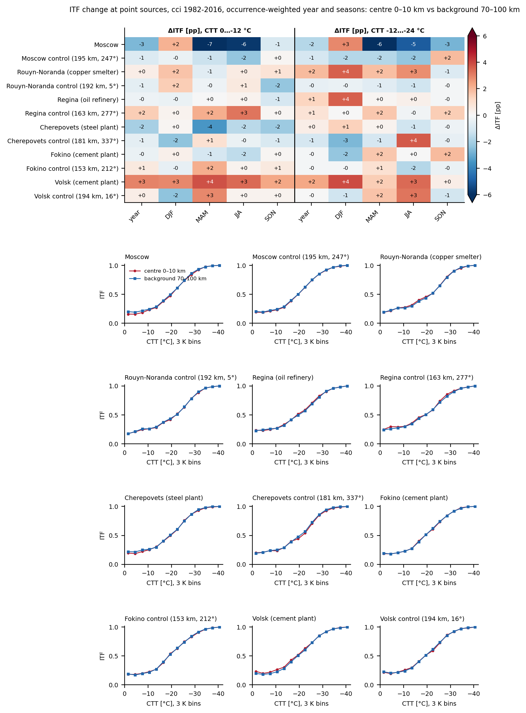
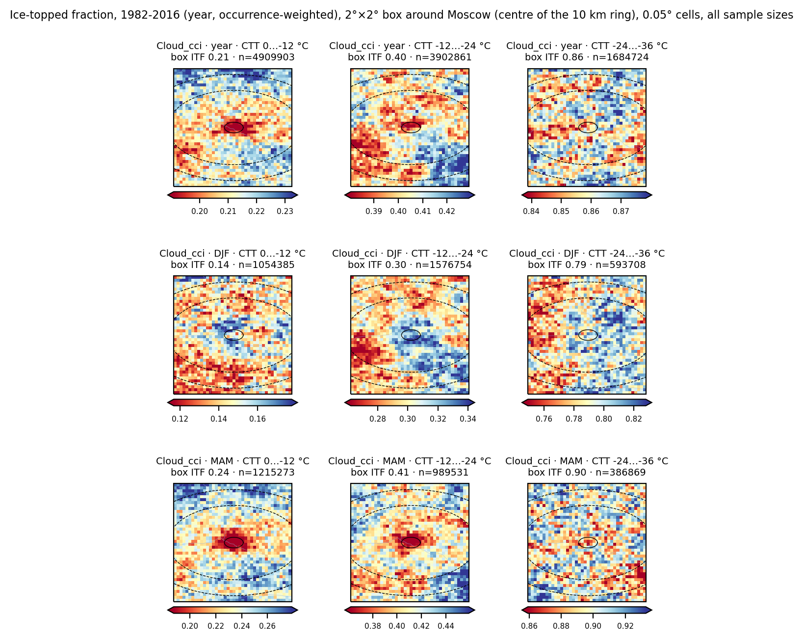
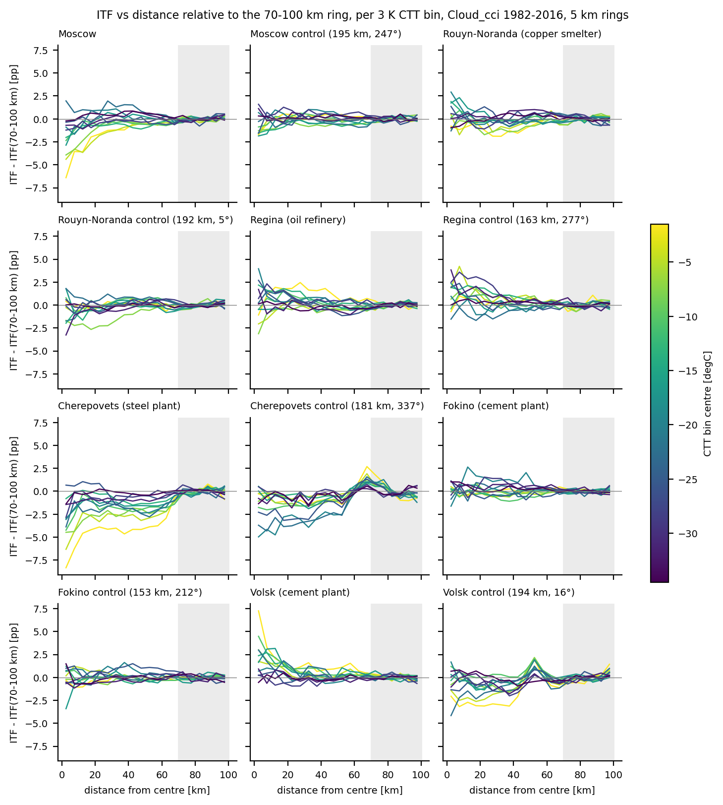

# itf-point-sources

Does aerosol from a point source change the temperature at which supercooled clouds glaciate? This repository
computes the ice-topped cloud fraction (ITF) versus cloud-top temperature (CTT) on the 0.05 degree grid in 2 x 2
degree boxes around six point sources and their random control boxes, and compares the centre with the background.
Data: ESA Cloud_cci v3 (1982-2016), CM SAF CLARA-A3 and NASA MODIS MYD06_L2 (2008). Details:
[docs/method.md](docs/method.md), [docs/products.md](docs/products.md).

The pooled 1982-2016 Cloud_cci counts of all 12 boxes are bundled (67 MB, `data/cci/`), so no download is needed
for the figures below.

## Example figures

More figures and commands: [summary_cci_figures/](summary_cci_figures/README.md).

ITF change, centre (0-10 km) minus background (70-100 km), per season and CTT range (top); ITF versus CTT (bottom).



```bash
bash scripts/run_sites.sh --root data --lane cci --year 1982-2016 --out-dir figs/cci_1982-2016 --no-maps
```

ITF maps around Moscow for three CTT ranges; rings at 10, 70 and 100 km.



```bash
python -m itf.plot_itf_maps --root data --box moscow --year 1982-2016 --months year --lanes cci --out-dir figs/cci_1982-2016
```

ITF versus distance, one line per 3 K CTT bin, relative to the 70-100 km ring (grey).



```bash
python -m itf.plot_itf_distance --root data --lane cci --year 1982-2016 --out-dir figs/cci_1982-2016
```

## Layout

```
sites.csv            site table (name, label, lat, lon, type, control_of); single source of truth
itf/                 python package: ctt_bins, modis_geo, sites, itf_day, itf_agg, itf_pool, index_modis,
                     plot_itf_change, plot_itf_change_sites, plot_itf_maps, plot_itf_distance
scripts/             bash drivers: cci_download, cci_select, clara_stage, modis_download, run_itf, run_year, run_sites
config.env.example   paths and resources (copy to config.env); config.sh applies the defaults
data/cci/<site>/     bundled counts: 1982-2016.nc (all years summed) and 1982-2016/MM.nc (per calendar month)
tests/               pytest unit test, synthetic-day generator and the end-to-end smoke test
docs/                method.md, products.md
```

## Installation

```bash
conda env create -f environment.yml && conda activate itf
cp config.env.example config.env     # edit the paths; only needed for the recompute from raw data
pytest tests && bash tests/test_smoke.sh
```

Run all commands from the repository root; `python -m itf.<module> --help` lists the options.

## Quick start

```bash
bash scripts/run_sites.sh --root data --lane cci --year 1982-2016 --out-dir figs/cci_1982-2016 --no-maps
```

Main result: `figs/cci_1982-2016/itf_change_sites_1982-2016_cci_season.png`. Each figure has a `.md` caption; per
site, `itf_change_<site>_1982-2016_cci.csv` and `itf_profile_<site>_1982-2016_cci.csv` hold the numbers. Step by step:

```bash
python -m itf.plot_itf_change --root data --box moscow --year 1982-2016 --lanes cci --out-dir figs/cci_1982-2016
python -m itf.plot_itf_change_sites --fig-dir figs/cci_1982-2016 --year 1982-2016 --lane cci --seasons
python -m itf.plot_itf_maps --root data --box moscow --year 1982-2016 --lanes cci --out-dir figs/cci_1982-2016
```

## Recomputing from raw data (example: Moscow, Cloud_cci, 2008)

Set `CCI_RAW`, `CCI_S1_ARCHIVE` and `OUT_ROOT` in `config.env` (raw data: about 330 GB per year).

```bash
bash scripts/cci_download.sh --year 2008                   # raw daily files -> CCI_RAW/2008/MM/
bash scripts/cci_select.sh --year 2008                     # cdo subsets -> CCI_S1_ARCHIVE/{intensive,extensive}/2008/MM/
for s in moscow moscow_ctl; do
    bash scripts/run_year.sh --product cci --site "$s" --year 2008      # daily counts, then monthly and yearly files
done
bash scripts/run_sites.sh --root "$OUT_ROOT" --lane cci --year 2008 --out-dir figs/cci_2008 --sites "moscow moscow_ctl"
```

Pool years with `python -m itf.itf_pool --agg-dir "$OUT_ROOT/cci/moscow" --years 1982 2016` (layout of `data/cci/`).
Other lanes: `scripts/clara_stage.sh --year 2008` or `LAADS_TOKEN=... bash scripts/modis_download.sh --year 2008 --doy 1 --doy-end 366`,
then `run_year.sh --product clara|modis|modis5`. A new site is one line in `sites.csv`.

## Outputs

```
OUT_ROOT/<lane>/daily/<site>/YYYY/MM/DD.nc   per day: n_liq, n_ice, n_mix, n_und, n_ctt (time, lat, lon, cosp_ht),
                                             n_obs (time, lat, lon), cot_sum and n_cot, itf; attributes with the
                                             phase rule and the source files
OUT_ROOT/<lane>/<site>/YYYY/MM.nc            the days of a month (one time step each); YYYY.nc the yearly sum
OUT_ROOT/<lane>/<site>/<a>-<b>.nc, <a>-<b>/MM.nc   multi-year pools (itf_pool.py)
OUT_ROOT/modis/index/YYYY/DDD.json           granule index of the MODIS lanes
figs/<dir>/itf_change_<site>_<year>_<lanes>.{png,md,csv}, itf_profile_<site>_<year>_<lane>.csv,
           itf_change_sites_<year>_<lane>[_season].{png,md}, itf_maps_<site>_<year>_<lanes>.{png,md}
figs/<dir>/<var>_distance_{12K,3K}_<year>_<lane>.{png,md}, itf_distance_<year>_<lane>.csv   (plot_itf_distance.py)
```

## Tests

`pytest tests` checks the CTT bins; `bash tests/test_smoke.sh` runs three synthetic days end to end.

## Citation and license

BSD 3-Clause (`LICENSE`). Cite the repository (`CITATION.cff`) and the data: Cloud_cci v3
(https://doi.org/10.5194/essd-12-41-2020), CLARA-A3 (https://doi.org/10.5194/essd-15-4901-2023), MODIS MYD06_L2
C6.1 (https://doi.org/10.5067/MODIS/MYD06_L2.061).
