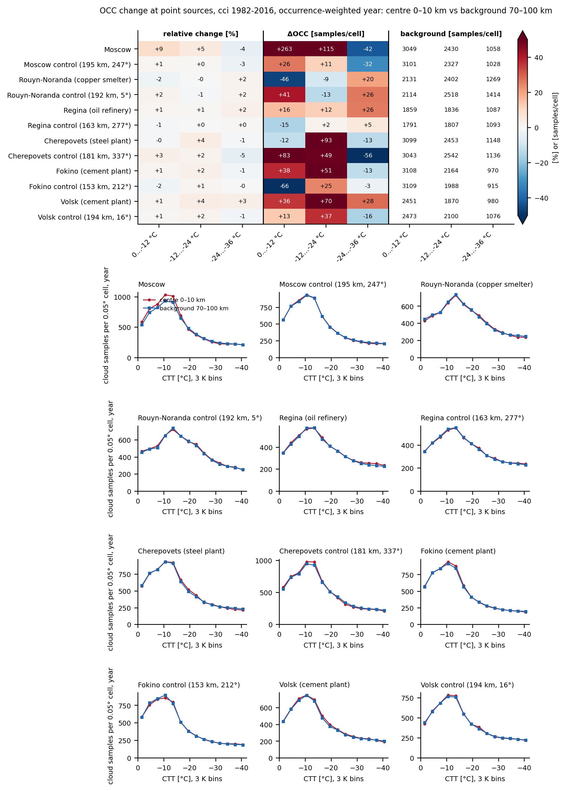
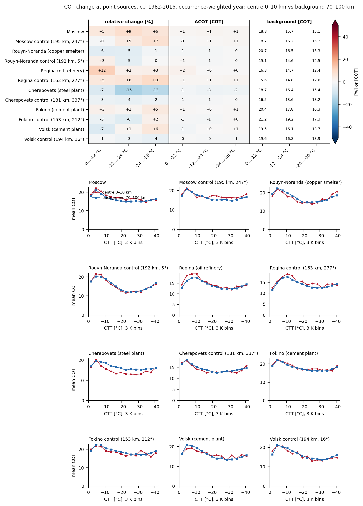
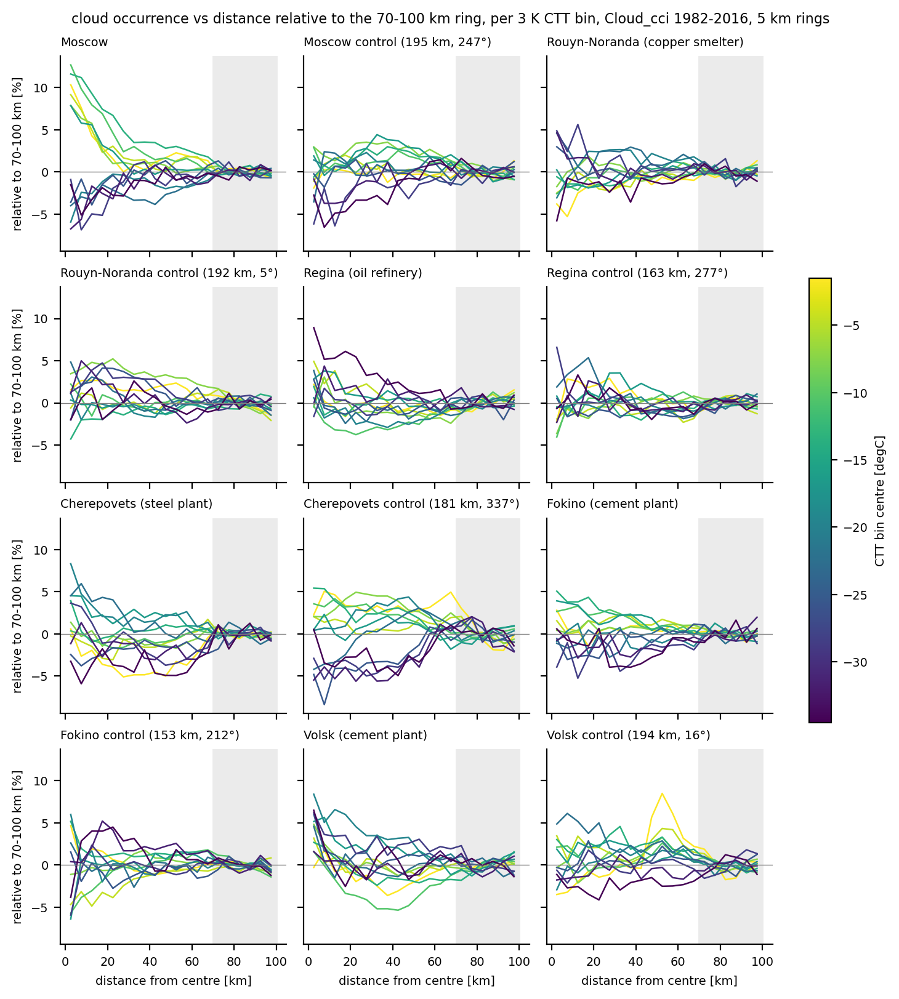
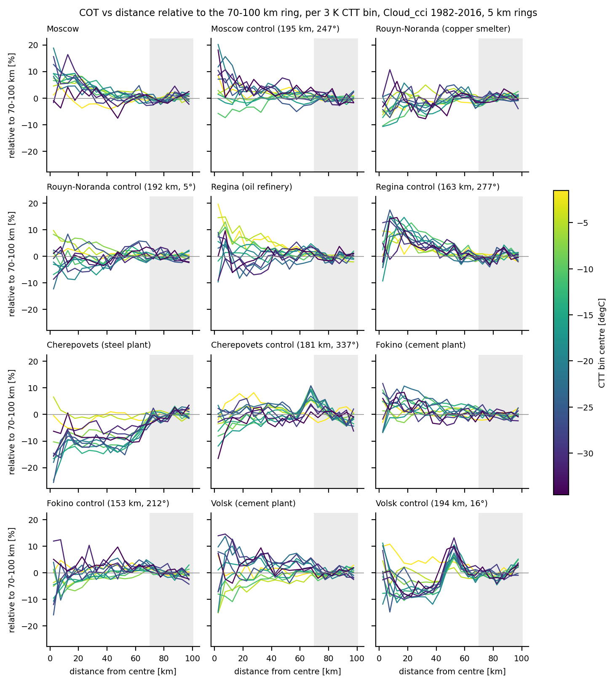

# Summary figures, Cloud_cci 1982-2016

Figures for the six point sources and their control boxes, drawn from the pooled counts bundled in `data/cci/`.
Centre = median over 0.05 degree cells 0-10 km from the site, background = median over 70-100 km. Run all commands
from the repository root; they write to `figs/cci_1982-2016/` (git-ignored) and take a few minutes.

| Figure | Content |
|---|---|
| `itf_change_sites_1982-2016_cci_season.png` | ITF change (centre minus background, percentage points) for the year and each season in two CTT ranges; ITF versus CTT per site |
| `itf_change_sites_1982-2016_cci_occ.png` | cloud occurrence (samples per cell) change per CTT range and occurrence versus CTT per site, yearly |
| `itf_change_sites_1982-2016_cci_cot.png` | mean cloud optical thickness change per CTT range and COT versus CTT per site, yearly (daytime retrievals) |
| `itf_distance_3K_1982-2016_cci.png` | ITF versus distance from the site (5 km rings), one line per 3 K CTT bin, minus the bin's own 70-100 km value (percentage points), one panel per box |
| `occ_distance_3K_1982-2016_cci.png` | as above for cloud occurrence, relative to the 70-100 km ring (%) |
| `cot_distance_3K_1982-2016_cci.png` | as above for mean COT, relative to the 70-100 km ring (%) |
| `itf_maps_moscow_1982-2016_cci.png` | ITF maps of the Moscow box for three CTT ranges, year, DJF and MAM |

## Commands

```bash
# 1. per-site change plots and CSVs for all 12 boxes, then the ITF season figure
bash scripts/run_sites.sh --root data --lane cci --year 1982-2016 --out-dir figs/cci_1982-2016 --no-maps

# 2. occurrence and COT versions (read the per-site CSVs written in step 1)
python -m itf.plot_itf_change_sites --fig-dir figs/cci_1982-2016 --year 1982-2016 --lane cci --profiles occ cot

# 3. Moscow maps (rows DJF and MAM from the default --seasons DJF MAM)
python -m itf.plot_itf_maps --root data --box moscow --year 1982-2016 --months year --lanes cci --out-dir figs/cci_1982-2016

# 4. ITF, occurrence and COT versus distance (also writes 12 K versions and itf_distance_1982-2016_cci.csv)
python -m itf.plot_itf_distance --root data --lane cci --year 1982-2016 --out-dir figs/cci_1982-2016
```

Each figure is written with a `.md` file of the same name describing its panels. Use `--box <site>` (names in
`sites.csv`) for the maps of another site.

## Previews








